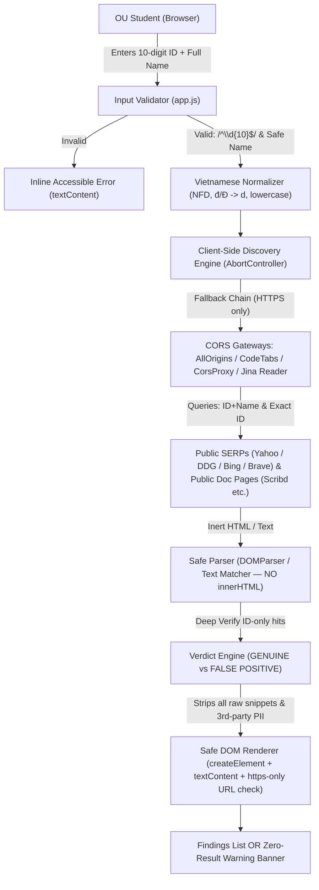

# Implementation Plan — OU Student ID & Name Exposure Self-Check Tool

**Project Location:** `vibe-code-project/` (sibling to `vibe-code-project/hcmc-ou-a-search/`, which MUST NOT be modified)  
**Target Deployment:** GitHub Pages (static site built from `main` branch root `/`)  
**Tool Title (EN / VI):** "Are your student ID and name exposed anywhere?" / "Mã số sinh viên và họ tên của bạn có bị lộ ở đâu không?"

---

## Section a) Feasibility of the Exposure Search on a Static GitHub Pages Site

### 1. Why Direct Browser Fetches Are Blocked & How Client-Side Discovery Works
A static site hosted on GitHub Pages (`https://<username>.github.io/...`) executes entirely inside the visitor's browser with zero backend server and zero secret storage.
- **CORS Limitation:** Major public search engines (DuckDuckGo HTML/Lite, Yahoo Search, Bing, Brave Search, Google) and document-hosting platforms (Scribd, Studocu, SlideShare, PDF repositories) do not send `Access-Control-Allow-Origin: *` headers on their HTML search endpoints. Consequently, a direct `fetch("https://html.duckduckgo.com/html/?q=...")` from browser JavaScript is blocked by the browser's Same-Origin Policy (CORS).
- **Zero-Secret Client-Side Architecture (Multi-Engine + Multi-Proxy Fallback Matrix):**
  To operate dynamically at runtime in a real browser without API keys or a custom backend server, the client-side search engine in `app.js` uses a **two-query strategy** executed across a **resilient CORS-friendly endpoint & proxy fallback chain**:
  1. **Query Strategy (Dual-Query & Deep-Page Verification):**
     - **Query A (Combined Exact ID + Name):** `"<10-digit-ID>" "<Student Name>"` — immediately surfaces documents indexed with both the exact 10-digit student ID and the student's name in the search engine snippet.
     - **Query B (Exact ID Broad Discovery):** `"<10-digit-ID>"` — discovers public web pages and document hosts (such as `scribd.com/document/...`, `scribd.com/doc/...`, university portals, public spreadsheets/PDFs) where the 10-digit ID is indexed, even if the search engine's 160-character snippet truncates the student's name.
     - **Deep Document/Snippet Verification Step:** When a search result from Query B matches the exact 10-digit ID in its title/snippet/URL but the snippet alone does not yet show the student's normalized name, `app.js` performs a secondary read-only fetch of either:
       - A targeted verification query (`"<10-digit-ID>" "<Normalized/Raw Name>" site:<discovered-domain>`), OR
       - The discovered target document URL via CORS proxy / text-extractor (`r.jina.ai` / `api.allorigins.win` / `api.codetabs.com`) to inspect the public document body/metadata for the normalized student name.
       This guarantees that if a public document (e.g., an indexed roster on Scribd or a public webpage) contains both the 10-digit ID and the student's name anywhere in its public text or search index, it is accurately verified as `GENUINE`.
  2. **Search Engines & Public CORS Endpoints (Fallback Chain):**
     The client iterates through a prioritized list of search providers and read-only CORS gateways with per-request `AbortController` timeouts (6,000 ms per attempt) so that if one gateway rate-limits (HTTP 429) or times out, the next provider seamlessly fulfills the request:
     - **Search Targets (HTML/Text SERPs):**
       1. **Yahoo Search HTML** (`https://search.yahoo.com/search?p=<encoded_query>&n=10`) — highly reliable via public proxies, lenient bot filtering compared to Google, and thoroughly indexes Scribd (`scribd.com/document/...`) and Vietnamese `.edu.vn` pages with rich text snippets (`.compTitle`, `.compText`, `a[href]`).
       2. **DuckDuckGo HTML / Lite** (`https://html.duckduckgo.com/html/?q=<encoded_query>` and `https://lite.duckduckgo.com/lite/?q=<encoded_query>`) — clean static HTML structure (`.result__a`, `.result__snippet`, `uddg=` redirect parameter decoding).
       3. **Bing Web Search HTML** (`https://www.bing.com/search?q=<encoded_query>`) — parses `.b_algo h2 a` and `.b_caption p`.
       4. **Brave Search HTML** (`https://search.brave.com/search?q=<encoded_query>`) — parses `#results .snippet` titles, links, and descriptions.
     - **CORS Proxy & Reader Gateways (No API Key Required):**
       1. **AllOrigins JSON/Raw** (`https://api.allorigins.win/get?url=<encoded_target_url>` and `https://api.allorigins.win/raw?url=<encoded_target_url>`) — returns `{ contents, status }` with permissive `Access-Control-Allow-Origin: *`.
       2. **CodeTabs CORS Proxy** (`https://api.codetabs.com/v1/proxy?quest=<encoded_target_url>`) — direct raw HTML response with `Access-Control-Allow-Origin: *`.
       3. **CorsProxy.io** (`https://corsproxy.io/?url=<encoded_target_url>`) — fast edge proxy fallback.
       4. **ThingProxy** (`https://thingproxy.freeboard.io/fetch/<target_url>`) — backup read-only proxy.
       5. **Jina Reader API (Keyless Free Tier)** (`https://r.jina.ai/<target_url>`) — converts public web pages and search URLs into clean Markdown/text with CORS enabled (`Access-Control-Allow-Origin: *`), useful both as a SERP reader and for deep-verifying public document pages (e.g., Scribd document previews).
  3. **Safe Client-Side Parsing (Zero `innerHTML`):**
     - All HTML responses from proxies are parsed strictly using `new DOMParser().parseFromString(rawHtml, "text/html")` into an inert, non-executing `Document` object (or regex/text extraction on inert strings for Markdown/Lite formats).
     - Search engine redirect wrappers (such as DuckDuckGo's `//duckduckgo.com/l/?uddg=<encoded_url>` or Yahoo's `RU=<encoded_url>/RK=...`) are unwrapped and validated via `new URL(candidateUrl)` to extract the canonical destination `https:` URL.
     - Results are deduplicated by canonicalized URL (stripping tracking query parameters like `utm_*`, `srsltid`, and normalizing mobile/regional subdomains like `vi.scribd.com` / `www.scribd.com` while preserving the exact HTTPS link).

### 2. Rate Limits, API Keys, Terms of Service (ToS), and Privacy Caveats
| Aspect | Assessment & Operational Constraint |
|---|---|
| **API Keys / Secrets** | **None (Zero secrets).** No Google Custom Search keys, no SerpApi keys, no Bing API keys, and no proxy tokens are used or committed. |
| **Rate Limits** | Public CORS proxies (`allorigins.win`, `codetabs.com`, `corsproxy.io`) and `r.jina.ai` enforce per-IP rate limits (typically 5–60 requests/minute per visitor IP). Because the tool runs in the visitor's own browser, requests are distributed across each student's individual IP rather than concentrated on a single server IP. A client-side cooldown (3 seconds between searches) and `AbortController` cancellation prevent accidental request flooding. |
| **Privacy Caveat of Public Proxies** | When a browser queries a public CORS proxy (`api.allorigins.win`, `api.codetabs.com`, `corsproxy.io`, `r.jina.ai`), the search query (`student ID` and `student name`) traverses that third-party proxy over HTTPS. The UI and `disclaimer.html` MUST explicitly disclose this before the user submits a search. |
| **Source Terms of Service (ToS) Risks** | Automated scraping of search engine result pages (SERPs) and document portals via third-party proxies may conflict with search engine ToS or trigger anti-bot CAPTCHAs under heavy traffic. When all automated public proxies fail or are rate-limited, the UI must degrade gracefully with a clear status alert (never fabricated results) and provide safe, user-initiated direct verification links (`rel="noopener noreferrer"`) so the user is never stranded. |
| **Recommended Production Alternative** | For long-term institutional deployment, the final report and `DECISIONS.md` recommend replacing third-party public CORS proxies with a **self-hosted serverless edge proxy** (e.g., a Cloudflare Worker on a custom domain calling an official paid Search API such as Brave Search API or Google Programmable Search Engine with server-held secrets and zero-log policies). Per project constraints, we do **not** add a custom backend server here; everything ships as a pure static GitHub Pages package. |

### 3. Explicit Normalization & Verdict Rules

#### A. Input Validation & Normalization Specification
1. **Student ID (`studentId`):**
   - **Validation Rule:** Must match `/^\d{10}$/` after trimming leading/trailing ASCII whitespace. Any non-digit character, fewer than 10 digits, or more than 10 digits is rejected client-side before any network call.
2. **Student Name (`studentName`):**
   - **Validation Rule:** After trimming and collapsing consecutive whitespace to a single space, length must be between `2` and `80` characters inclusive, must contain at least one Unicode letter (`/\p{L}/u`), and must match `/^[\p{L}\s'.\-]+$/u` (linear-time character class; rejects digits, HTML brackets `< >`, quotes, and script syntax).
   - **Normalization Function (`normalizeVietnameseName(str)`):**
     ```js
     function normalizeText(input) {
       return String(input)
         .normalize("NFD")
         .replace(/[\u0300-\u036f]/g, "") // strip all combining diacritical marks
         .replace(/đ/g, "d")
         .replace(/Đ/g, "d")
         .toLowerCase()
         .replace(/[^a-z0-9\s]/g, " ")    // turn punctuation/hyphens into space boundaries
         .replace(/\s+/g, " ")
         .trim();
     }
     ```
   - **Matching Semantics:**
     - **ID Match (`hasId`):** The candidate document text (title + snippet + URL slug + optional fetched page body) contains the exact 10-digit `studentId` bounded by non-digit boundaries (`new RegExp(`(^|\\D)${studentId}(\\D|$)`).test(rawText)`), preventing partial matches inside 11+ digit phone numbers or timestamps.
     - **Name Match (`hasName`):** `normalizeText(candidateText)` contains the normalized full `studentName` as a contiguous token sequence (word-boundary matched: `new RegExp(`(^|\\s)${escapeRegExp(normalizedName)}(\\s|$)`).test(normalizedCandidateText)`), OR when a document slug/OCR splits tokens, every token of `normalizedName` (for multi-word names >= 2 tokens) appears in close proximity (within a 60-character window) in `normalizedCandidateText`.

#### B. Explicit Verdict Rule (`GENUINE` vs. `FALSE POSITIVE`)
Every discovered web result is evaluated against `hasId` and `hasName` (including after deep verification of the result page or combined ID+Name query confirmation) and assigned one of two verdicts:

| Verdict | Condition | Matched Fields Indicator | One-Line Reason Template (EN / VI) |
|---|---|---|---|
| **`GENUINE`** | `hasId === true` **AND** `hasName === true` in the same source document (via title/snippet/URL or fetched document text/combined exact-match query verification). | `Matched: Student ID + Student Name` / `Khớp: Mã số sinh viên + Họ và tên` | `"Both your exact 10-digit Student ID and normalized full name appear together in this public source."` / `"Cả Mã số sinh viên (10 chữ số) và Họ tên (đã chuẩn hóa) đều xuất hiện trong cùng nguồn công khai này."` |
| **`FALSE POSITIVE`** (Case 1: ID Only) | `hasId === true` **AND** `hasName === false` (even after secondary page/query check). | `Matched: Student ID only` / `Chỉ khớp: Mã số sinh viên` | `"Only the 10-digit number matched; your student name was not confirmed in the public preview (may be an unrelated number or requires manual check)."` / `"Chỉ khớp chuỗi 10 chữ số; không xác nhận thấy họ tên của bạn trong bản xem trước công khai (có thể là dãy số ngẫu nhiên hoặc cần kiểm tra thủ công)."` |
| **`FALSE POSITIVE`** (Case 2: Name Only) | `hasId === false` **AND** `hasName === true`. | `Matched: Student Name only` / `Chỉ khớp: Họ và tên` | `"Only a matching name was found without your 10-digit Student ID (common name collision / needs manual check)."` / `"Chỉ tìm thấy họ tên trùng khớp nhưng không có Mã số sinh viên 10 chữ số (trùng tên phổ biến / cần kiểm tra thủ công)."` |

- **No Raw Snippet / Third-Party PII Echoing:** Regardless of verdict, the result card displays **ONLY**:
  1. **Source Name & Type** (e.g., `Scribd Document (scribd.com)`, `University Portal (ou.edu.vn)`, `Public PDF Document`, `Web Page (<hostname>)`),
  2. **Direct HTTPS Link** (validated `https://...` anchor with `rel="noopener noreferrer" target="_blank"`),
  3. **Verdict Badge** (`GENUINE` or `FALSE POSITIVE`),
  4. **Matched Fields Indicator** (`Student ID + Student Name`, `Student ID only`, or `Student Name only`),
  5. **Standardized One-Line Reason** (from the deterministic template above — never raw scraped text snippets from the source document, because source rosters often list dozens of other students' names, birthdates, and IDs on the same line!).
- **Zero-Result Requirement:** When no matching sources are found, the UI displays a clear empty state and MUST include the exact required warning:
  - English: **"absence of results does not prove your data is not exposed"**
  - Vietnamese: **"Việc không tìm thấy kết quả không chứng minh rằng dữ liệu của bạn chưa từng bị lộ."**

---

## Section b) Impeccable Framework Design-Rules Summary & Official OU Blue Hex

### 1. Official Ho Chi Minh City Open University (OU) Signature Blue Verification
We verified the official Ho Chi Minh City Open University (`ou.edu.vn`) brand colors across three authoritative sources:
1. **Repository Root [`README.md`](file:///c:/Users/hp/Desktop/MyProjects/Course-Projects-From-OU-Students/README.md#L19):** Uses the official OU shield badge `` specifying **`#005BAC`** as the primary OU signature brand blue.
2. **Official `ou.edu.vn` Production Stylesheets (`https://ou.edu.vn/wp-content/themes/education/style_phe.css`, `css/style_l.css`, and `style.css`):**
   - Primary UI accent blue on `ou.edu.vn` headers, section banners, buttons, and active links: **`#1956B3`** (RGB `25, 86, 179`) and content link blue **`#1D559F`** (RGB `29, 85, 159`).
   - Deep institutional heading ink on `ou.edu.vn`: **`#000022`**.
3. **Harmonized Palette & WCAG AA Contrast Ratios:**
   We anchor our design tokens in `styles.css` on Official OU Signature Blue **`#005BAC`** (with `#1956B3` as the official `ou.edu.vn` web stylesheet companion and `#004280` as the darkened hover/focus variant):
   - **`--ou-blue-primary: #005BAC`** on pure white `#FFFFFF` surface → **Contrast Ratio: `6.84:1`** (Passes WCAG AA `4.5:1` for normal text and `3.0:1` for large text/UI controls; approaches AAA).
   - **`--ou-blue-web: #1956B3`** (`ou.edu.vn` CSS header blue) on `#FFFFFF` → **Contrast Ratio: `6.81:1`** (Passes WCAG AA).
   - **`--ou-blue-deep: #003E78`** (active/heading accent) on `#FFFFFF` → **Contrast Ratio: `10.45:1`** (Passes WCAG AAA).
   - **`--ink-primary: #0B192C`** (deep academic navy-ink on `#F6F8FB` canvas) → **Contrast Ratio: `16.2:1`** (Passes WCAG AAA).
   - **`--ink-secondary: #33475B`** (tinted slate-blue secondary text, avoiding neutral gray on tinted surfaces) on `#F6F8FB` → **Contrast Ratio: `8.6:1`** (Passes WCAG AAA).
   - **Verdict Badges (Dual-Encoded with Icon/Label + Color):**
     - `GENUINE` (High-Attention Exposure Alert): Background `#FCECEB`, Border `#B83227`, Text `#7F1B13` → **Contrast Ratio: `8.35:1`** (Passes WCAG AAA).
     - `FALSE POSITIVE` (Amber Manual-Check Notice): Background `#FDF3E1`, Border `#9E6208`, Text `#663D00` → **Contrast Ratio: `7.42:1`** (Passes WCAG AAA).
     - `INFO / SAFE NOTICE`: Background `#E6F0F8`, Border `#005BAC`, Text `#003E78` → **Contrast Ratio: `9.10:1`** (Passes WCAG AAA).

### 2. Design Rules We Will Apply (Impeccable Framework v4.10.0)
Derived directly from `pbakaus/impeccable` (`SKILL.md`, `DESIGN.md`, `reference/mode-operate.md`, `reference/craft-floor.md`, `reference/typeset.md`, `reference/layout.md`, `reference/colorize.md`, `reference/harden.md`, `reference/clarify.md`, and `reference/audit.md`), `vtthanh-implementor` MUST apply the following concrete rules:

1. **Surface Mode (`Operate` + `Read` Hybrid):**
   - Visitors arrive to perform a high-trust privacy self-check (`Operate`) and understand the verdict/disclaimer (`Read`).
   - Ambition shows as **precision, restraint, and immediate scannability**. The interface must read immediately as a trustworthy academic security self-check instrument—no marketing fluff, no fake dashboards, no decorative clutter.
2. **Strict Anti-Slop Bans (`craft-floor.md` & Detector Rules):**
   - **NO Eyebrows / Kickers Above Headings:** Never place a small uppercase label/pill directly above an `<h1>` or `<h2>`. Let the heading carry its own weight.
   - **NO Card-in-Card Nesting:** Never nest a `.card` inside another bordered/shadowed `.card`. Group related items with spatial proximity (`gap`) and hairline dividers (`1px solid var(--border-subtle)`) instead of wrapping every element in a box.
   - **NO One-Sided Accent Bars (`side-tab` ban):** Never put a `border-left: 4px solid ...` on alerts, cards, or findings. Use a full `1px solid` semantic border, a subtle tinted surface background, and a leading status badge/icon.
   - **NO Purple-to-Blue Gradients, Gradient Text, Neon Dark Glows, or Decorative Glassmorphism:** No `background-clip: text`, no `backdrop-filter: blur()` decoration, and no zero-offset glowing shadows.
   - **NO Icon-Tile Stacks or Hero-Metric Clichés:** Do not place rounded-square icon tiles above section headings, and do not render fake "01 / 02 / 03" step numbers or decorative sparklines/progress rings.
   - **NO Emoji as UI Icons:** Never use raw emoji (`🔍`, `⚠️`, `✅`) as structural UI icons. Use clean, authored inline SVGs with consistent `1.75px` stroke width and `aria-hidden="true"`.
3. **Typography & Hierarchy (`typeset.md`):**
   - **Font Stack (Zero External Network Requests for Fonts):** To satisfy strict supply-chain (`CWE-829`) and CSP (`font-src 'self'`) rules while respecting Vietnamese diacritics and OU's typography:
     - Primary UI & Body (`--font-sans`): `"Be Vietnam Pro", "Segoe UI Variable Text", "Segoe UI", Roboto, system-ui, -apple-system, sans-serif`.
     - Monospace (`--font-mono`, strictly for the 10-digit Student ID input, verdict tags, HTTP status/domain metadata — **"The Mono Means Machine Rule"**): `ui-monospace, "Cascadia Mono", "SF Mono", "JetBrains Mono", Consolas, monospace`.
   - **Scale & Measure:**
     - Body text floor: `1rem` (`16px`) across all viewports (critical on mobile so iOS Safari never force-zooms focused `<input>` elements).
     - Clear hierarchy (>1.25× step between main heading and body): `h1` at `clamp(1.625rem, 2.5vw, 2.125rem)` (`font-weight: 700`, `letter-spacing: -0.02em`, `text-wrap: balance`), `h2` at `1.25rem` (`font-weight: 600`), body at `1rem` (`line-height: 1.6`, `text-wrap: pretty`).
     - Reading measure constrained to `60ch–72ch` (`max-width: 720px` main column) so long bilingual explanations and legal clauses never stretch past `80ch`.
     - Use `font-variant-numeric: tabular-nums` on Student ID inputs, counters, and timestamps.
4. **Layout, Spacing & Touch Targets (`layout.md` & `audit.md`):**
   - **4px Base Spacing Scale:** `--sp-1: 4px`, `--sp-2: 8px`, `--sp-3: 12px`, `--sp-4: 16px`, `--sp-5: 20px`, `--sp-6: 24px`, `--sp-8: 32px`, `--sp-10: 40px`.
   - **Heading Rhythm:** Always provide more vertical space above a section heading than below it (e.g., `margin-top: var(--sp-8); margin-bottom: var(--sp-3)`).
   - **Interactive Touch Targets:** Every `<button>`, `<input>`, language toggle, and link button must have a minimum interactive height/width of **`44px × 44px`** (`min-height: 44px`) and internal padding `>= 12px` (avoiding `cramped-padding`).
   - **Browser Surfaces Themed:** Explicitly style `::selection` (OU Blue tint), `caret-color: var(--ou-blue-primary)`, and `:focus-visible` (`outline: 2px solid var(--ou-blue-primary); outline-offset: 2px`).
5. **Hardening, Copy & States (`harden.md` & `clarify.md`):**
   - **Persistent Form Labels:** `<label for="student-id">` and `<label for="student-name">` are always visible above inputs, with format rules shown upfront before submission (not hidden solely in `placeholder`).
   - **Complete UI States:** Explicitly design and wire:
     1. **Initial / Ready State** (clear self-check privacy notice + upfront proxy disclosure),
     2. **Validation Error State** (inline field error linked via `aria-describedby`, specific recovery guidance, no user blame),
     3. **Loading / Progress State** (`aria-live="polite"`, cancellable via a `Stop / Hủy` button hooked to `AbortController`, showing which search stage is running),
     4. **Findings State** (summary count + list of deduplicated finding rows with `GENUINE` / `FALSE POSITIVE` badges, matched fields indicator, one-line reason, and validated HTTPS link),
     5. **Empty / Zero-Results State** (includes the mandatory `"absence of results does not prove your data is not exposed"` banner),
     6. **Network / Proxy Degraded State** (honest explanation if all public CORS proxies rate-limit or fail, plus safe manual search links so the student can still verify directly).
   - **Motion Sensitivity:** Respect `@media (prefers-reduced-motion: reduce)` by replacing spinner animations with static/opacity indicators without removing state feedback.

---

## Section c) Architecture, File List, and Security Design Mapped to CWE Checklist

### 1. Exact File List in `Course-Projects-From-OU-Students/vibe-code-project/`
All files for this tool reside directly inside `vibe-code-project/`. We **do not touch** `vibe-code-project/hcmc-ou-a-search/` or its contents.

| File Path (relative to repo root) | Role & Responsibilities |
|---|---|
| `vibe-code-project/index.html` | Main self-check application page (bilingual VI/EN support). Includes strict `<meta http-equiv="Content-Security-Policy">`, semantic landmarks (`<header>`, `<main>`, `<form>`, `<section aria-live="polite">`, `<footer>`), persistent labels, privacy self-check framing, and footer link to `./disclaimer.html`. |
| `vibe-code-project/disclaimer.html` | Standalone bilingual (Vietnamese & English) Legal Disclaimer, Privacy & Terms of Use page covering all required clauses, with the same strict CSP meta tag and footer link back to `./index.html` and `./disclaimer.html`. |
| `vibe-code-project/404.html` | Clean static Not-Found fallback page inside `vibe-code-project/` (per Impeccable `not-found-page` foundation & GitHub Pages best practices) with strict CSP and navigation back to `./index.html` and `./disclaimer.html`. |
| `vibe-code-project/styles.css` | Shared stylesheet implementing Official OU Blue (`#005BAC` / `#1956B3`) design tokens, WCAG AA/AAA verified contrast pairs, Impeccable craft-floor rules, responsive layout (`320px` to desktop), `44px` minimum touch targets, print/overflow hardening, and `@media (prefers-reduced-motion: reduce)`. |
| `vibe-code-project/app.js` | Pure vanilla ES2022 client-side logic: frame-busting check, input validation (`^\d{10}$` and Unicode name validation), Vietnamese diacritic normalization (`NFD` + `đ/Đ -> d`), multi-proxy/multi-engine exposure discovery & deep verification, deterministic `GENUINE` vs `FALSE POSITIVE` grading, strict `https:` URL sanitizer, and safe DOM rendering via `document.createElement` + `textContent` only. |
| `vibe-code-project/app.test.js` | Automated Node.js (`node --test`) verification suite testing input validation, ReDoS immunity, Vietnamese normalization, `GENUINE` vs `FALSE POSITIVE` verdict logic, PII redaction (ensuring raw snippets are never output), URL protocol sanitization (`javascript:`/`data:`/`http:` rejection), and static source scans for `innerHTML`/prohibited patterns. |
| `vibe-code-project/PLAN.md` | This comprehensive architecture, research, design, security, deployment, and disclaimer specification document. |
| `vibe-code-project/DECISIONS.md` | Record of conservative architectural, security, privacy, and UX decisions made during Phase 1 & Phase 2. |
| `vibe-code-project/README.md` | Existing reflection note (preserved; append or update with concise local run/test and live GitHub Pages documentation without removing the author's existing bilingual notes). |

### 2. Component & Data-Flow Architecture



### 3. Security Design Mapped Explicitly to CWE Checklist

#### 1. CWE-79: Improper Neutralization of Input During Web Page Generation (Cross-Site Scripting / XSS)
- **DOM Sink Ban:** `app.js` MUST NOT contain `innerHTML`, `outerHTML`, `insertAdjacentHTML`, `document.write`, `document.writeln`, `eval`, `new Function`, `setTimeout("<string>")`, or `setInterval("<string>")`.
- **Safe Rendering Only:** Every dynamic string (validation messages, status updates, source hostnames, verdict badges, reasons, and anchor text) is inserted exclusively via `Node.textContent` and constructed via `document.createElement()`.
- **No Raw Input Echo as HTML:** User input is never echoed back as HTML. Even in status banners, the Student ID is masked or formatted as plain text via `textContent`.
- **No Inline Scripts or Inline Event Handlers:** Zero `<script>...</script>` inline blocks and zero `onclick=`, `onsubmit=`, `onload=`, or `style="..."` attributes in `index.html`, `disclaimer.html`, or `404.html`. All event listeners are attached in `app.js` via `addEventListener`.
- **Strict Content Security Policy (CSP):** Applied via `<meta http-equiv="Content-Security-Policy" ...>` in `<head>` of `index.html`, `disclaimer.html`, and `404.html`, with **NO `unsafe-inline`** and **NO `unsafe-eval`**:
  ```html
  <meta http-equiv="Content-Security-Policy" content="default-src 'none'; script-src 'self'; style-src 'self'; connect-src https://api.allorigins.win https://api.codetabs.com https://corsproxy.io https://thingproxy.freeboard.io https://r.jina.ai; img-src 'self' data:; font-src 'self'; base-uri 'none'; form-action 'none'; object-src 'none';" />
  ```
  - **Exact Allowed `connect-src` Origins:**
    1. `https://api.allorigins.win`
    2. `https://api.codetabs.com`
    3. `https://corsproxy.io`
    4. `https://thingproxy.freeboard.io`
    5. `https://r.jina.ai`

#### 2. CWE-352: Cross-Site Request Forgery (CSRF)
- **Stateless Client-Side Architecture:** The application has no backend database, no user accounts, no session cookies, no bearer tokens, and no state-changing endpoints (`POST`/`PUT`/`DELETE`).
- **Form Submission Lockdown:** CSP enforces `form-action 'none'`. The `<form>` in `index.html` omits the `action` attribute and is handled strictly via `form.addEventListener("submit", (e) => { e.preventDefault(); ... })`.
- **Cross-Origin Fetch Credentials:** All `fetch()` calls to public CORS gateways explicitly set `credentials: "omit"` and `referrerPolicy: "no-referrer"` so the browser never attaches ambient cookies or the user's GitHub Pages referrer URL to outbound proxy requests.

#### 3. CWE-89 (SQL Injection), CWE-78 (OS Command Injection), & CWE-94 (Code Injection)
- **CWE-89 (SQLi):** There is no SQL/NoSQL database, no WebSQL, and no IndexedDB query concatenation anywhere in the architecture.
- **CWE-78 (OS Command Injection):** Runs purely inside the browser sandbox on static GitHub Pages; there is no server runtime or shell execution capability.
- **CWE-94 (Code Injection):** No `eval()`, `Function()`, dynamic `<script>` tag injection, or `import()` of user-supplied strings. JSON responses from `api.allorigins.win` are parsed strictly with `JSON.parse()`.

#### 4. CWE-601 (URL Redirection to Untrusted Site / Open Redirect) & CWE-1021 (Improper Restriction of Rendered UI Layers / Clickjacking)
- **CWE-601 Mitigation:**
  - The app never performs automatic `window.location` redirects based on URL parameters or search results.
  - Every discovered external link is parsed through a strict validator before creating an `<a href="...">`:
    ```js
    function sanitizeHttpsUrl(rawUrl) {
      try {
        const parsed = new URL(String(rawUrl).trim());
        if (parsed.protocol !== "https:") return null;
        if (parsed.username || parsed.password) return null;
        return parsed.href;
      } catch {
        return null;
      }
    }
    ```
  - This blocks `javascript:`, `data:`, `vbscript:`, `file:`, `http:`, and credential-stuffed URLs.
  - Every external anchor element sets `target="_blank"` and `rel="noopener noreferrer external"`.
- **CWE-1021 (Clickjacking) Mitigation & GitHub Pages Header Limitation:**
  - **Limitation Documented:** GitHub Pages is a static host that does not allow custom HTTP response headers, and per the W3C CSP Level 2/3 specification, browsers ignore `frame-ancestors` and `X-Frame-Options` when delivered inside `<meta http-equiv="...">` tags.
  - **Client-Side Defense-in-Depth:** At startup in `app.js`, the application checks `if (window.top !== window.self)`. If framed inside an external document, `app.js` disables the search form, hides interactive controls, displays a high-contrast security warning instructing the user to open the tool directly in a top-level tab, and attempts `window.top.location = window.self.location.href` within a `try/catch` block.

#### 5. CWE-20 (Improper Input Validation) & CWE-1333 (Inefficient Regular Expression Complexity / ReDoS)
- **Strict Allowlist Validation:**
  - `studentId`: Trimmed string must match `/^\d{10}$/` (exact length 10, ASCII digits `0-9` only). Checked in $O(1)$ time.
  - `studentName`: Trimmed string length strictly bounded (`2 <= length <= 80` code units). Validated with flat, non-nested character class regex `/^[\p{L}\s'.\-]+$/u` and `/\p{L}/u`.
- **ReDoS Immunity (CWE-1333):**
  - Zero regexes with nested quantifiers (such as `(a+)+` or `(\s*\w+)+`) exist in `app.js`.
  - Dynamic regexes constructed from normalized user inputs first bound input length (`<= 80` chars) and escape all special regex metacharacters via `str.replace(/[.*+?^${}()|[\]\\]/g, "\\$&")`.
  - Proxy response bodies are capped to `512 KB` (`524,288` characters) before parsing or matching to prevent memory/CPU exhaustion from oversized upstream pages.

#### 6. CWE-798 (Use of Hard-coded Credentials) & CWE-200 (Exposure of Sensitive Information to an Unauthorized Actor)
- **CWE-798:** Zero API keys, tokens, passwords, or secrets exist anywhere in the codebase.
- **CWE-200 (Strict Privacy-by-Design & Third-Party PII Redaction):**
  - **No Storage:** The app never touches `localStorage`, `sessionStorage`, `indexedDB`, `document.cookie`, or Cache API for user queries or results. All form fields use `autocomplete="off"`.
  - **No Third-Party PII Reproduction:** Public university rosters (e.g., on Scribd) frequently contain tables with 50+ students' full names, student IDs, dates of birth, and phone numbers. Our parser inspects the fetched text in memory **solely** to compute the boolean flags `hasId` and `hasName`, and then immediately discards the raw text. The UI never renders raw document excerpts or surrounding lines.
  - **Referrer Leakage Prevention:** `<meta name="referrer" content="no-referrer" />` is set in all HTML pages so clicking an external result link never leaks the GitHub Pages URL or any page state in the `Referer` header.

#### 7. CWE-829 (Inclusion of Functionality from Untrusted Control Sphere) & CWE-1104 (Use of Unmaintained Third Party Components)
- **Zero External Runtime Dependencies:** No npm runtime packages, no CDN scripts (no jQuery, no React, no Tailwind CDN, no FontAwesome CDN, no Google Fonts stylesheet links).
- 100% self-contained vanilla HTML5, CSS3, and ES2022 JavaScript served from `'self'`.

#### 8. CWE-319 (Cleartext Transmission of Sensitive Information)
- All proxy/search requests in `connect-src` and `app.js` use `https://` exclusively.
- Outbound result links with `http://` are either upgraded to `https://` (if known HTTPS host) or rejected by `sanitizeHttpsUrl()`.

---

## Section d) GitHub Pages Deployment Plan

### 1. Repository Branch & Folder Topology
- **Repository:** `Course-Projects-From-OU-Students`
- **GitHub Pages Configuration:** Set in GitHub **Settings → Pages → Build and deployment**:
  - **Source:** `Deploy from a branch`
  - **Branch:** `main`
  - **Folder:** `/ (root)`
- **Coexistence with Existing Projects:**
  - The repository root serves `/`.
  - The existing project at `vibe-code-project/hcmc-ou-a-search/` continues to be served untouched at `https://<owner>.github.io/<repo>/vibe-code-project/hcmc-ou-a-search/`.
  - Our new exposure self-check tool sits directly in `vibe-code-project/` and is served at:
    - Main Tool: `https://<owner>.github.io/<repo>/vibe-code-project/` (and `/vibe-code-project/index.html`)
    - Legal Disclaimer: `https://<owner>.github.io/<repo>/vibe-code-project/disclaimer.html`
    - Fallback 404 Page: `https://<owner>.github.io/<repo>/vibe-code-project/404.html`

### 2. Relative Path & Asset Resolution Strategy
To ensure the application works identically whether served from:
1. GitHub Pages at `/<repo>/vibe-code-project/`,
2. A local static server started at the repository root (`npx serve .` → `http://localhost:3000/vibe-code-project/`), or
3. A local static server started inside `vibe-code-project/` (`python -m http.server 8080` → `http://localhost:8080/`),

**Every asset and internal page reference MUST use explicit relative paths (`./`):**
- Stylesheet: `<link rel="stylesheet" href="./styles.css" />`
- Script: `<script src="./app.js" defer></script>`
- Disclaimer link: `<a href="./disclaimer.html">`
- Home link (from `disclaimer.html` and `404.html`): `<a href="./index.html">`
- Never use root-relative paths (`/styles.css` or `/vibe-code-project/styles.css`), which break when the repository name or local server mount point changes.

### 3. Pre-Merge & Post-Merge Verification Steps
1. **Local Automated Verification (Pre-Commit):**
   - Run `node --test vibe-code-project/app.test.js` to verify normalization, validation, verdict grading, PII redaction, URL sanitization, and zero-`innerHTML` compliance.
   - Run a repository-wide grep/scan to confirm zero occurrence of any prohibited live-test student ID or name.
2. **Local Browser Smoke Test:**
   - Serve `vibe-code-project/` locally via HTTP server (`python -m http.server 8080 --directory vibe-code-project`), verify zero CSP violations in DevTools console, test bilingual toggle, invalid input rejections, and live exposure discovery.
3. **Post-Merge GitHub Pages Verification:**
   - After merging to `main`, GitHub Actions `pages-build-deployment` automatically deploys the static files within ~60 seconds.
   - Verify `https://<owner>.github.io/<repo>/vibe-code-project/index.html` and `https://<owner>.github.io/<repo>/vibe-code-project/disclaimer.html` return HTTP 200 over HTTPS, enforce the `<meta http-equiv="Content-Security-Policy">` policy with zero console errors, and render properly on mobile (`375px`) and desktop (`1280px`) viewports.

---

## Section e) `disclaimer.html` Content Specification

`vibe-code-project/disclaimer.html` MUST be a complete, accessible, bilingual (**Tiếng Việt** and **English**) HTML5 document sharing `./styles.css` and the strict Content Security Policy. It MUST be linked prominently from the `<footer>` of every page (`index.html`, `disclaimer.html`, and `404.html`), and `index.html` must also link to `./disclaimer.html` right beside the search form's privacy notice.

### Required Sections & Exact Clause Coverage in `disclaimer.html`

#### 1. Non-Affiliation with Ho Chi Minh City Open University (OU) / Tuyên bố không liên kết chính thức
- **Vietnamese:** Công cụ này là một dự án học thuật mã nguồn mở độc lập do sinh viên thực hiện. Công cụ **không** trực thuộc, **không** đại diện, **không** được tài trợ hay phê duyệt chính thức bởi Trường Đại học Mở Thành phố Hồ Chí Minh (HCMOU / `ou.edu.vn`). Tên trường và màu sắc nhận diện chỉ được tham chiếu nhằm mục đích định hướng ngữ cảnh hỗ trợ sinh viên tự kiểm tra.
- **English:** This tool is an independent, student-created open-source educational project. It is **not** affiliated with, endorsed by, sponsored by, or officially connected to Ho Chi Minh City Open University (HCMOU / `ou.edu.vn`). References to the university name and brand color are strictly for contextual identification for students performing self-checks.

#### 2. Informational & Educational Self-Check Purpose Only / Mục đích tự kiểm tra và giáo dục
- **Vietnamese:** Công cụ chỉ dành riêng cho mục đích thông tin, nâng cao nhận thức bảo mật và hỗ trợ sinh viên **tự kiểm tra thông tin cá nhân của chính mình** (Self-Check). Nghiêm cấm việc sử dụng công cụ này để tra cứu hàng loạt, thu thập dữ liệu trái phép (scraping/doxxing) hoặc xâm phạm quyền riêng tư của người khác.
- **English:** This tool is provided strictly for informational, cybersecurity-awareness, and educational **self-check** purposes ("check your own information"). Using this tool for bulk harvesting, unauthorized profiling, doxxing, or infringing upon another individual's privacy is strictly contrary to its intended use.

#### 3. Provided "As Is" Without Warranty / Cung cấp "Nguyên trạng" không bảo đảm
- **Vietnamese:** Phần mềm và kết quả tra cứu được cung cấp trên cơ sở **"NGUYÊN TRẠNG" ("AS IS")** theo Giấy phép MIT, không kèm theo bất kỳ bảo đảm nào, dù明示 (rõ ràng) hay ngụ ý, bao gồm nhưng không giới hạn ở bảo đảm về tính chính xác, độ tin cậy, tính khả dụng liên tục hoặc sự phù hợp cho một mục đích cụ thể.
- **English:** This software and its outputs are provided **"AS IS"** under the MIT License, without warranty of any kind, express or implied, including but not limited to warranties of accuracy, completeness, continuous availability, merchantable quality, or fitness for a particular purpose.

#### 4. Accuracy Limitations & Mandatory "Absence of Results" Warning / Giới hạn độ chính xác & Cảnh báo bắt buộc
- **Vietnamese:** Kết quả tìm kiếm phụ thuộc vào chỉ mục công khai của các máy chủ tìm kiếm bên thứ ba và các cổng proxy CORS công cộng tại thời điểm truy vấn; do đó kết quả có thể bị trễ, bị giới hạn tần suất (rate-limited), chưa đầy đủ hoặc có sai sót (bao gồm cả dương tính giả hoặc âm tính giả). Đặc biệt lưu ý: **Việc không tìm thấy kết quả không chứng minh rằng dữ liệu của bạn chưa từng bị lộ** (*"absence of results does not prove your data is not exposed"*).
- **English:** Search results depend on third-party public search indices and public CORS proxy gateways at the moment of the query; consequently, results may be incomplete, delayed, rate-limited, or inaccurate (including false positives or false negatives). Crucially: **"absence of results does not prove your data is not exposed"**.

#### 5. Zero Storage, Zero Logging & Public Proxy Transmission Disclosure / Chính sách Không lưu trữ & Minh bạch truyền tải qua Proxy
- **Vietnamese:**
  - **Không lưu trữ bởi kho mã nguồn này:** Trang web tĩnh này chạy hoàn toàn trên trình duyệt của bạn (trên GitHub Pages). Kho lưu trữ này và chủ sở hữu **không** có cơ sở dữ liệu, **không** ghi nhật ký (logs), **không** dùng công cụ phân tích (analytics/tracking), và **không** lưu dữ liệu bạn nhập hoặc kết quả tìm kiếm vào `cookies`, `localStorage` hay `sessionStorage`.
  - **Bảo vệ dữ liệu bên thứ ba:** Công cụ không bao giờ trích xuất hay hiển thị đoạn văn bản thô chứa thông tin cá nhân của người khác từ tài liệu nguồn; giao diện chỉ hiển thị tên nguồn, liên kết HTTPS, nhãn đánh giá (`GENUINE` / `FALSE POSITIVE`) và lý do tóm tắt một dòng.
  - **Lưu ý về cổng truy vấn công cộng:** Để vượt qua giới hạn CORS của trình duyệt mà không cần máy chủ riêng, truy vấn tìm kiếm của trình duyệt được gửi qua các dịch vụ proxy/đọc web công cộng chỉ đọc (`api.allorigins.win`, `api.codetabs.com`, `corsproxy.io`, `thingproxy.freeboard.io`, `r.jina.ai`) tới các công cụ tìm kiếm công khai. Các hạ tầng bên thứ ba này hoạt động theo chính sách bảo mật riêng của họ.
- **English:**
  - **Zero Storage by This Repository:** This static application runs entirely inside your browser on GitHub Pages. This repository and its owner operate **no database**, collect **no logs**, run **no analytics or telemetry**, and store **nothing** in `cookies`, `localStorage`, or `sessionStorage`.
  - **Third-Party PII Redaction:** The tool never reproduces raw text snippets or third-party personal data from source documents; it displays only the source hostname/type, direct HTTPS link, verdict (`GENUINE` or `FALSE POSITIVE`), matched-field badge, and a standardized one-line reason.
  - **Public CORS Proxy Disclosure:** Because browsers block direct cross-origin search fetches on static sites, your browser sends the search query over HTTPS through public read-only CORS/reader gateways (`api.allorigins.win`, `api.codetabs.com`, `corsproxy.io`, `thingproxy.freeboard.io`, `r.jina.ai`) to public search engines. Those external services are governed by their own respective privacy policies.

#### 6. External Links & Third-Party Sources / Liên kết ngoài và Nguồn bên thứ ba
- **Vietnamese:** Các liên kết HTTPS xuất hiện trong kết quả dẫn tới các trang web bên thứ ba (như Scribd, các cổng tài liệu hoặc trang web bên ngoài) không thuộc quyền kiểm soát của công cụ này. Chủ sở hữu kho mã nguồn không chịu trách nhiệm về nội dung, tính hợp pháp hoặc chính sách bảo mật của bất kỳ trang web bên thứ ba nào. Nếu bạn phát hiện thông tin của mình bị đăng tải công khai trên trang bên thứ ba, bạn cần liên hệ trực tiếp với quản trị viên hoặc bộ phận hỗ trợ gỡ bỏ nội dung (DMCA / Privacy Takedown) của trang web đó.
- **English:** Direct HTTPS links presented in the findings point to external third-party websites (such as Scribd, document repositories, or external web hosts) that are not operated or controlled by this tool. The repository owner bears no responsibility for the content, availability, legality, or privacy practices of any third-party site. To remove exposed personal data found on an external platform, you must use that platform's official privacy or takedown procedure.

#### 7. Not Legal, Cybersecurity, or Professional Advice / Không phải tư vấn pháp lý hoặc chuyên môn
- **Vietnamese:** Không có nội dung nào trên trang web này cấu thành tư vấn pháp lý, tư vấn an toàn thông tin chuyên nghiệp hoặc kết luận điều tra số.
- **English:** Nothing presented by this tool or documentation constitutes legal advice, formal cybersecurity auditing, or professional compliance guidance.

#### 8. Contact & Takedown Route / Liên hệ & Yêu cầu hỗ trợ / gỡ bỏ
- **Vietnamese:** Nếu bạn có thắc mắc, phản hồi về bảo mật hoặc yêu cầu điều chỉnh/gỡ bỏ liên quan đến mã nguồn công cụ này, vui lòng mở Issue trực tiếp trên GitHub tại: `https://github.com/JuniorThanhBQ/Course-Projects-From-OU-Students/issues`.
- **English:** For questions, security reports, or takedown/modification requests regarding this open-source tool, please open an issue on the official GitHub repository: `https://github.com/JuniorThanhBQ/Course-Projects-From-OU-Students/issues`.

#### 9. Explicit Recommendation for Qualified Legal Review / Khuyến nghị tham vấn luật sư có chuyên môn
- **Vietnamese:** **Lưu ý dành cho Chủ sở hữu Kho lưu trữ:** Tuyên bố miễn trừ trách nhiệm này giúp làm rõ mục đích sử dụng và giảm thiểu rủi ro hiểu lầm, nhưng **không thể loại bỏ hoàn toàn mọi rủi ro pháp lý**. Chủ sở hữu kho lưu trữ được khuyến nghị rõ ràng nên nhờ một **luật sư có chuyên môn phù hợp** rà soát lại toàn bộ văn bản miễn trừ trách nhiệm này trước khi vận hành rộng rãi, đặc biệt liên quan đến các quy định hiện hành về bảo vệ dữ liệu cá nhân (như Nghị định 13/2023/NĐ-CP tại Việt Nam).
- **English:** **Important Note to the Repository Owner:** While a clear disclaimer reduces misunderstanding and legal exposure, **a disclaimer reduces but cannot eliminate legal risk**. It is explicitly recommended that the repository owner have this disclaimer text reviewed by a **qualified lawyer** familiar with applicable data-protection and cybersecurity laws (including Vietnam's Personal Data Protection Decree No. 13/2023/ND-CP) before broad public distribution.
